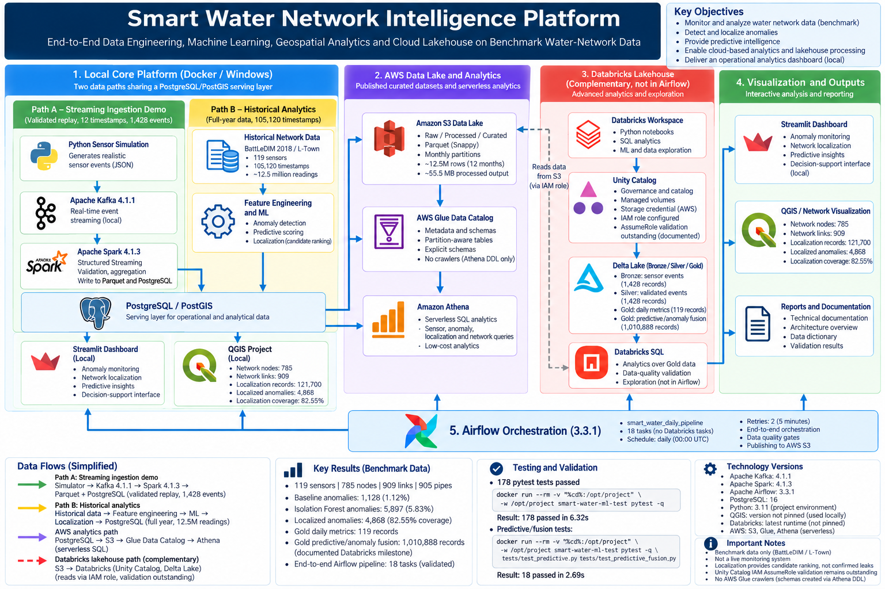
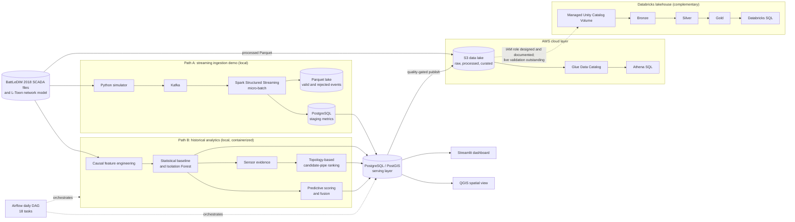

# Smart Water Network Intelligence Platform

An end-to-end **data engineering, machine learning, geospatial, cloud and lakehouse platform** for water-distribution sensor data. It validates and stores sensor data, detects abnormal network behaviour, ranks candidate pipes for investigation, publishes quality-checked datasets to an AWS data lake, queries them with Athena, orchestrates the workflow with Airflow, and presents the results in a dashboard and a GIS project.

> **Important:** This is a simulation and benchmark project. It uses the public BattLeDIM 2018 / L-Town water-network dataset. It is **not a live monitoring system for a real water utility**, it is not connected to live telemetry, and anomaly or localization results must not be interpreted as confirmed leaks. Results are benchmark results, not operational KPIs.

## At a glance

| | |
|---|---|
| **Problem** | Turn raw water-network sensor data into validated, queryable, explainable analytics: detect abnormal periods, explain them with sensor evidence and point investigators to candidate pipes. |
| **Data** | BattLeDIM 2018 SCADA data: 105,120 timestamps at 5-minute intervals, 119 sensors, about 12.5 million readings. L-Town network: 785 nodes, 909 links. |
| **Built** | Kafka and Spark streaming ingestion demo, PostgreSQL/PostGIS serving layer, causal ML, topology-based localization, quality-gated publishing to S3, Glue Data Catalog, Athena, an 18-task Airflow workflow, a Databricks Delta Lake layer, QGIS and Streamlit. |
| **Reliability** | Deterministic event IDs, idempotent writes, explicit quality gates, Airflow retries and validation tasks, 178 automated tests (run in Docker), Dockerized infrastructure. |
| **Cloud** | S3 data lake, Glue Data Catalog and Athena on AWS. A complementary Databricks lakehouse (Unity Catalog, Bronze/Silver/Gold). Glue crawlers are intentionally not used. |
| **Honest limits** | Benchmark data only. Localization is candidate ranking and is not accurate enough to name the leaking pipe. The Databricks-to-AWS IAM role was designed and documented, but its live AssumeRole validation is outstanding. |

## Contents

1. [Problem and scope](#1-problem-and-scope)
2. [Architecture](#2-architecture)
3. [Data source and network model](#3-data-source-and-network-model)
4. [Streaming ingestion path](#4-streaming-ingestion-path)
5. [Anomaly detection and predictive intelligence](#5-anomaly-detection-and-predictive-intelligence)
6. [Localization and GIS](#6-localization-and-gis)
7. [Dashboard](#7-dashboard)
8. [Airflow orchestration](#8-airflow-orchestration)
9. [AWS data lake and analytics](#9-aws-data-lake-and-analytics)
10. [Databricks lakehouse](#10-databricks-lakehouse)
11. [Data engineering reliability](#11-data-engineering-reliability)
12. [Testing and validation](#12-testing-and-validation)
13. [Security](#13-security)
14. [Technology stack](#14-technology-stack)
15. [Repository structure](#15-repository-structure)
16. [Running the project](#16-running-the-project)
17. [Known limitations](#17-known-limitations)
18. [Project evolution](#18-project-evolution)
19. [How to review this project](#19-how-to-review-this-project)
20. [Author](#20-author)

## 1. Problem and scope

Water utilities collect pressure, flow, tank-level and demand measurements, but raw SCADA data is not directly useful: it has to be validated, stored reliably, analysed for abnormal behaviour and presented in a form investigators can act on.

This project builds that chain end to end on a public benchmark, and it deliberately focuses on engineering quality: how the data is validated, stored, orchestrated and checked, and how limitations are reported.

**What it is:** a portfolio project that demonstrates data engineering, ML, geospatial and cloud skills on realistic water-network data.

**What it is not:** a deployed or live system, a source of operational KPIs, or a leak-confirmation tool.

## 2. Architecture

### 2.1 Overall architecture



The platform is a hybrid of three layers: a local core platform, an AWS data lake and analytics layer, and a complementary Databricks lakehouse. The detailed architectural reference is [`docs/final_architecture.md`](docs/final_architecture.md).

### 2.2 Two data paths

The platform has two workloads that share a PostgreSQL/PostGIS serving layer. They are not one continuously running production pipeline.

- **Path A, streaming ingestion demo.** A Python simulator replays historical observations as events. Kafka and Spark Structured Streaming validate and aggregate them and write Parquet and PostgreSQL. The validated replay covers 12 five-minute timestamps (1,428 events).
- **Path B, historical analytics.** Feature engineering, anomaly detection, localization and predictive scoring read the full-year BattLeDIM data directly and write their results to PostgreSQL.



### 2.3 Components

| Component | Responsibility |
|---|---|
| Python | Simulation, feature engineering, anomaly detection, localization, cloud publishing |
| Apache Kafka | Event ingestion for the streaming demo |
| Apache Spark | Validation, event-time processing, aggregation and persistence (Structured Streaming, run as a micro-batch job) |
| PostgreSQL and PostGIS | Operational, analytical and spatial serving: sensor metrics, anomaly results, localization results, network geometry |
| Parquet | Event storage, the processed sensor-readings dataset, curated exports |
| Amazon S3 | Cloud data lake with raw, processed and curated zones |
| AWS Glue Data Catalog | Metadata for the data-lake tables; Glue crawlers are intentionally not used |
| Amazon Athena | Serverless SQL over the S3 data |
| Apache Airflow | Daily orchestration, retries and validation gates |
| scikit-learn | Isolation Forest anomaly detection |
| Databricks, Delta Lake, Unity Catalog | A complementary lakehouse layer with Bronze, Silver and Gold tables and Databricks SQL |
| QGIS | Spatial investigation of localization results |
| Streamlit | Interactive dashboard |
| Docker | Reproducible infrastructure and ML execution environment |

### 2.4 What runs where

| Layer | Where | Notes |
|---|---|---|
| Kafka, Spark, PostgreSQL/PostGIS, Airflow, ML, Streamlit, QGIS | Local (Docker and Windows) | The core platform |
| S3, Glue Data Catalog, Athena | AWS | Quality-gated publication and serverless SQL |
| Delta Lake tables, Databricks SQL | Databricks workspace | Complementary lakehouse layer |

AWS services were chosen only where they add value. Kafka, Spark, PostgreSQL and Airflow stay local on purpose, because at this data volume managed equivalents would add cost without adding capability. Managed Kafka (MSK), Kinesis, EMR, Redshift, RDS, managed Airflow, EC2/NAT gateways and SageMaker were evaluated and deliberately not used.

## 3. Data source and network model

The project uses the **BattLeDIM 2018 historical dataset** and the **L-Town EPANET network model**. L-Town is a benchmark network. It is not a real utility network.

| Measurement | Sensors | Unit |
|---|---:|---|
| Pressure | 33 | m |
| Flow | 3 | m3/h |
| Tank level | 1 | m |
| Demand | 82 | L/h |
| **Total** | **119** | |

The SCADA data has **105,120 timestamps at 5-minute intervals** with 119 readings at each, which gives **12,509,280 readings**.

```text
Sensors          119
Network nodes    785
Network links    909   (905 pipes, 1 pump, 3 valves)
```

Sensor identity is the pair (sensor type, sensor ID). A few node IDs carry both a pressure and a demand sensor, so a sensor ID alone is not unique across types.

**Coordinates.** The network uses the BattLeDIM/L-Town **local model coordinate system (SRID 0)**. No geographic coordinate reference system is assigned, and no geographic coordinates are invented.

Known leakage events are kept separate from detector and localization inputs and are used only for evaluation, not for training or threshold tuning. Raw source data is preserved unchanged and is not committed to Git.

## 4. Streaming ingestion path

The simulator converts historical observations into chronological events and publishes them to the Kafka topic `water-sensor-events`. Each event has a deterministic ID built from sensor type, sensor ID and timestamp, so the same reading always receives the same ID.

Spark Structured Streaming runs as a **micro-batch job** (not a continuously running service). It performs JSON parsing, schema and structural validation, event-time processing with a 10-minute watermark and 15-minute sensor aggregation. Valid events go to Parquet, rejected events are quarantined, and aggregated metrics go to PostgreSQL.

A controlled validation replay produced:

```text
1,428 sensor events (12 timestamps x 119 sensors)
1,428 valid events
0 rejected events
476 staging metrics and 476 serving metrics (4 windows x 119 sensors)
```

Repeated serving-layer execution stayed at 476 records, which demonstrates idempotent persistence for this workload. The Parquet lake also de-duplicates by event ID before appending, so replaying the simulator does not create duplicate events (see section 11).

## 5. Anomaly detection and predictive intelligence

Path B reads the full-year benchmark data and uses **causal** features: every value is computed from earlier observations only.

### 5.1 Statistical baseline

An explainable baseline based on causal weekly deviation. A sensor is abnormal when its absolute z-score is at least 3, and a network anomaly is raised when at least 15 of the 119 sensors are abnormal at the same time. Each z-score uses only earlier data, after a 7-day calibration period.

### 5.2 Isolation Forest

An unsupervised model on **357 causal features** (119 sensors x 3 feature types: 5-minute change, 1-hour change and weekly deviation). Configuration: `n_estimators = 200`, `contamination = "auto"`, `random_state = 42`. The anomaly threshold is fixed at the 99th percentile of training-period scores, without using future data or leakage labels.

### 5.3 Evaluation against known leakage events

Both detectors were evaluated against the **14 known BattLeDIM leakage events**.

| Measure | Statistical baseline | Isolation Forest |
|---|---:|---:|
| Anomaly timestamps | 1,128 | 5,897 |
| Anomaly rate (of 101,088 scored timestamps) | 1.12% | 5.83% |
| Alert within 24 h of a known leak | 8 / 14 | 13 / 14 |
| Alert within 72 h | 12 / 14 | 14 / 14 |
| Mean first-alert delay | 30.08 h | 7.10 h |
| Median first-alert delay | 15.50 h | 4.79 h |
| Maximum first-alert delay | 107.25 h | 33.00 h |

The results show a trade-off between earlier warning and alert volume. They do not show that one detector is better in general. The evaluation covers detection timing for 14 events and the overall alert rate. It does not report precision or false-alarm rates, and 14 events is a small sample, so these figures describe this benchmark and should not be read as operational performance.

### 5.4 Predictive scoring and fusion

The workflow also includes production predictive-scoring and fusion steps that combine predictive scores with the anomaly results. Their outputs are validated before publication, are published to the AWS data lake and are processed in the Databricks Gold layer. Unit tests cover both modules.

## 6. Localization and GIS

### 6.1 From detection to candidate pipes

Isolation Forest gives a network-level score but does not say which sensors caused it. The localization layer therefore uses causal statistical **sensor evidence** to identify abnormal measurements, attributes them to the network graph, and ranks pipes.

```text
Detection  ->  Interpretation  ->  Localization (candidate ranking)
```

Candidate pipes are ranked with a transparent heuristic:

```text
contribution = |sensor z-score| / (1 + topology distance in hops)
```

The **Top 25 candidate pipes** are stored for each localizable ML anomaly timestamp. The ranking is an investigation aid. **It is not a probability that a pipe is leaking and it does not confirm a leak.**

### 6.2 Results

| Item | Result |
|---|---:|
| ML anomaly timestamps | 5,897 |
| Localized anomaly timestamps | 4,868 |
| Unlocalized ML anomaly timestamps | 1,029 |
| Localization coverage | 82.55% |
| Localization records (4,868 x 25) | 121,700 |
| Distinct candidate pipes | 495 |

### 6.3 Evaluation against known leaks

| Metric | Result |
|---|---:|
| Known leakage events | 14 |
| Localization available | 13 / 14 |
| Exact Top-1 matches | 0 |
| Top-5 / Top-10 matches | 0 / 0 |
| Top-25 matches | 4 |
| Median true-pipe rank | 160 |
| Median Rank-1 distance to the true pipe | 25 network hops |

The heuristic produces candidate pipes, but it is **not accurate enough to identify the leaking pipe**: only 4 of the 13 evaluable leaks appear in the Top 25, and the median true pipe is ranked 160th. This limitation is reported rather than hidden.

### 6.4 GIS

Localization results are joined to PostGIS network geometry through a QGIS serving view. The QGIS project shows the pipe network, the candidate pipes for a chosen anomaly, candidate rank and Top-5 labels. Because the network uses local model coordinates, the map assigns no geographic CRS.

## 7. Dashboard

A Streamlit application on top of the PostgreSQL serving layer provides decision support for investigating the benchmark results. It reads four dedicated PostgreSQL views (`dashboard_anomaly_daily`, `dashboard_anomaly_detail`, `dashboard_localization_summary`, `dashboard_localization_candidates`) defined in `sql/06_create_dashboard_views.sql`.

| Page | Content |
|---|---|
| Network Overview | 119 sensors, 785 nodes, 909 links, 905 pipes |
| Anomaly Monitoring | Anomaly totals and rates, baseline and ML activity, timeline, filters, evidence for a selected event |
| Network Localization | Localized anomaly count and coverage, candidate-pipe activity, ranked candidates for a selected timestamp |

Validated figures shown by the dashboard: 101,088 scored timestamps (2018-01-15 to 2018-12-31), 5,897 ML anomaly timestamps (5.83%), 1,128 baseline anomaly timestamps (1.12%) and 82.55% localization coverage. The most active day was 2018-07-19, with 76 ML anomaly timestamps (26.39% of that day's 288). These indicate periods of elevated detected anomaly activity. They do not establish the physical cause.

The dashboard runs locally and is **not connected to live utility telemetry**. It has **not been publicly deployed**.

## 8. Airflow orchestration

Airflow (3.3.1) runs the daily batch workflow `smart_water_daily_pipeline` for the serving, analytics and publication stages, providing orchestration, task dependencies, retries and validation gates. It does **not** run the simulator, Kafka or Spark.

| Setting | Value |
|---|---|
| Schedule | `@daily`: 00:00 UTC, which is 02:00 in Rwanda |
| Retries | 2 |
| Retry delay | 5 minutes |
| Catchup | Off |

The DAG has **18 tasks**. Validation tasks sit between stages, so publication happens only after the preceding results have been validated.

| Stage | Tasks |
|---|---|
| Serving layer | PostgreSQL connectivity check; sensor-metric upsert; metric validation; reference-data validation; lake-quality validation |
| Anomaly detection | Anomaly detection; anomaly validation |
| Localization | Localization; localization validation |
| Curated export | Read-only curated export to Parquet |
| Predictive intelligence | Production predictive scoring; production fusion; predictive-fusion validation |
| Publication to S3 | Anomaly results; localization results; network links; network nodes; predictive-fusion results |

Task IDs are defined in `infrastructure/airflow/dags/smart_water_daily_pipeline.py`. A second DAG, `smart_water_aws_test.py`, is an AWS connectivity test. A manual run of the daily DAG was validated with **all 18 tasks successful**. The Airflow Databricks provider was integrated, but the Databricks processing in section 10 is not one of the 18 tasks.

The DAG demonstrates orchestration, retries and validation gates over a static historical dataset. It is not an incremental production ingestion schedule.

## 9. AWS data lake and analytics

### 9.1 S3 data lake

```text
s3://<bucket>/
  raw/            source files as received
  processed/      validated, typed, de-duplicated Parquet
  curated/        analytics-ready tables
  manifests/      publish records
  athena-results/ Athena query output
```

- **Processed sensor readings:** about **12.5 million rows** in **12 monthly Parquet files** (Snappy), about **55.5 MB** in total, partitioned as `processed/sensor_readings/year=2018/month=MM/`.
- **Curated datasets:** anomaly results, localization results, network nodes and network links, plus the predictive-fusion results, exported from PostgreSQL and published by the Airflow publication tasks. Geometry is exported as WKT text and no SRID is added.
- **Quality-controlled publishing:** a quality gate runs before conversion and upload (structure, timestamps, units, finite and non-negative values, completeness, duplicates). Output is read back and verified, and re-running overwrites the same keys instead of duplicating data.

### 9.2 Glue Data Catalog and Athena

- The `smart_water` Glue database holds tables with explicit schemas. **Glue crawlers are intentionally not used**; schemas are known and table definitions are created through Athena DDL. The sensor-readings table is partition-aware (`year`, `month`).
- Athena queries the catalog serverlessly using the primary workgroup, with query results written to a separate `athena-results/` location. Analyses cover sensor readings, consumption, anomalies, missing readings and operational and network KPIs. No traditional data warehouse was introduced.
- Queries filter on the partition columns and select only the needed columns, which keeps scans small.

### 9.3 Security and cost controls

- Authenticator-app MFA on the account, and a dedicated IAM user for command-line access with narrowly scoped S3 permissions. Credentials stay in the AWS CLI profile, outside the repository.
- S3: Block Public Access, default encryption (SSE-S3), a bucket policy that denies non-HTTPS requests, and lifecycle rules (Athena results expire after 7 days, incomplete multipart uploads are aborted).
- AWS Budgets alerting. The design is cost-conscious: small data volumes, serverless querying and no always-on managed services.

## 10. Databricks lakehouse

Databricks is a **complementary lakehouse layer**. It does not replace the local platform or the AWS data lake. It demonstrates Unity Catalog governance, Delta Lake tables and Databricks SQL on the project's data.

### 10.1 What was built and validated

A notebook (`notebooks/databricks/10_databricks_smart_water_validation.py`) ran in a Databricks workspace with Unity Catalog and a managed Unity Catalog Volume, and built three Delta layers.

| Layer | Content | Validated result |
|---|---|---|
| Bronze | Sensor events from the validated streaming replay | 1,428 records |
| Silver | Cleaned sensor events | 1,428 records; zero null event IDs, event times, sensor IDs and sensor types |
| Gold | Daily sensor metrics | 119 aggregated records |
| Gold | Predictive/anomaly fusion | 1,010,888 records (documented milestone) |

Databricks SQL analytics were run over the Gold data. The Bronze and Silver layers hold the small streaming-replay sample, not the full 12.5-million-row history.

### 10.2 AWS IAM integration status

The Databricks-to-AWS access configuration was **established and documented** in `docs/phase_11_databricks_iam.md`. It consists of:

- a dedicated AWS IAM role;
- a Databricks storage credential;
- a Unity Catalog trust relationship, including an external ID;
- S3 permissions for the project's data.

**Configuration is not validation.** The live Databricks-to-AWS AssumeRole path was **not successfully validated end to end**, so S3 access from Databricks must be regarded as configured and documented but unproven. The processing in section 10.1 was run on data in the managed Unity Catalog Volume. The README deliberately contains no role identifiers, and the documentation contains no credentials.

## 11. Data engineering reliability

| Control | How it works | Why it matters |
|---|---|---|
| Deterministic event IDs | ID built from sensor type, sensor and timestamp | The same reading always has the same identity, so duplicates are detectable |
| Parquet de-duplication | The Spark job removes duplicates within a batch and drops events already stored; the first stored copy is kept | Replays and checkpoint resets cannot double the lake (a real bug found and fixed during development) |
| Idempotent PostgreSQL writes | Upserts on natural keys | Re-running a task does not create duplicate rows |
| Source validation | Spark and the simulator check structure, units and known sensor types; rejected events are quarantined | Bad events are isolated and not silently dropped |
| Quality gates | Schema, nulls, finite values, known sensor types, units, non-negative values, timestamp completeness, plausible ranges (plausible-range is a warning) | Publishing fails closed when data is wrong |
| Read-only export | The curated export runs in a read-only, repeatable-read transaction | The serving database cannot be modified by the export, and tables come from one consistent snapshot |
| Retries and validation tasks | Two retries, five-minute delay, validation between stages | Transient failures recover and bad data stops the workflow |
| Verification after publishing | Files are read back and compared before and after upload | Uploaded data matches what was validated |
| Reproducible infrastructure | Docker Compose, configuration templates, setup verified from a fresh clone | Others can rebuild the local platform |

## 12. Testing and validation

### 12.1 Automated unit and logic tests

The suite in `tests/` covers the simulator data contract, feature engineering, the baseline detector, predictive scoring and fusion, the quality checks, the cloud quality gate, Parquet conversion and the read-only curated export. Tests run without AWS credentials and without a live database.

In the final validation, run inside the **Docker ML test environment**, **178 pytest tests passed**, including the **18 predictive-scoring and fusion tests**.

**Environment note:** the local Windows Python environment has a SciPy/scikit-learn DLL loading issue. This is an environment problem and not a failure in project logic, which is why the complete suite was run in Docker. A subset of 52 pure-Python cloud quality-gate, core quality-check and Parquet tests was also validated directly in the local environment.

The final full-suite validation was run in the Docker ML test environment with:

```cmd
docker run --rm -v "%cd%:/opt/project" -w /opt/project smart-water-ml-test pytest -q
```

Latest result:

```text
178 passed in 7.14s
```

The predictive-scoring and fusion modules were also validated separately with:

```cmd
docker run --rm -v "%cd%:/opt/project" -w /opt/project smart-water-ml-test pytest -q tests/test_predictive.py tests/test_predictive_fusion.py
```

Result:

```text
18 passed in 2.69s
```

For developers using the local Python environment, the standard commands are:

```cmd
pip install -r requirements-dev.txt
python -m pytest
```

### 12.2 Spark-specific validation

The idempotent Parquet write is verified by a separate Spark test run inside the Spark container (`tests/test_lake_dedup.py`). Its result was `lake de-duplication works (4 unique events stored)`. It needs Spark, so it is not part of the pytest run above.

### 12.3 End-to-end and data-layer validation

A manual run of the daily Airflow DAG completed with all 18 tasks successful, and the PostgreSQL serving layer was then validated:

| Check | Result |
|---|---:|
| Sensor metrics (staging and serving) | 476 |
| Anomaly rows | 101,088 |
| ML anomaly timestamps | 5,897 |
| Baseline anomaly timestamps | 1,128 |
| Localized anomaly timestamps | 4,868 |
| Unlocalized ML anomaly timestamps | 1,029 |
| Localization rows | 121,700 |
| Network nodes / links | 785 / 909 |
| Invalid Top-25 groups | 0 |
| Localization without an ML anomaly | 0 |
| Non-pipe candidates | 0 |
| Missing network links or geometries | 0 |
| Duplicate timestamp and pipe pairs | 0 |
| Null or negative localization scores | 0 |

## 13. Security

- **No secrets in Git.** Environment files, AWS credentials, keys and tokens are excluded by `.gitignore` (`.env`, `*.env`, `.aws/`, `*.pem`, `*.key`). Only the template `infrastructure/postgres/.env.example` is tracked.
- **AWS.** IAM is used as an access-control mechanism: a dedicated CLI user with scoped S3 permissions, MFA on the account, Block Public Access, encryption and HTTPS-only access on the bucket. Credentials stay in the AWS CLI profile.
- **Final repository check.** A final check found no AWS access key, secret or other credential in tracked project content. Strings such as `AKIA` or `aws_secret_access_key` appear only inside security-check documentation and are not credentials.
- **No account-specific identifiers in this README.** The real bucket name, account details and role identifiers are not shown here; templates use placeholders.
- **Scope.** This is a learning project and not an enterprise security architecture. See the limitations for the Docker-socket trade-off.

## 14. Technology stack

| Technology | Role / version |
|---|---|
| Python | Simulation, feature engineering, ML, localization, cloud publishing |
| Pandas, NumPy, PyArrow | Data processing and Parquet |
| scikit-learn | Isolation Forest |
| Apache Kafka 4.1.1 | Event ingestion |
| Apache Spark 4.1.3 (Structured Streaming) | Validation and aggregation |
| PostgreSQL, PostGIS | Serving, spatial data |
| Apache Airflow 3.3.1 | Orchestration |
| Amazon S3, AWS Glue Data Catalog, Amazon Athena | Data lake, metadata, serverless SQL |
| AWS IAM, AWS Budgets | Access control, cost monitoring |
| Databricks, Delta Lake, Unity Catalog, Databricks SQL | Complementary lakehouse |
| Streamlit | Dashboard |
| QGIS | Spatial visualization; version not pinned in the repository |
| Docker, Docker Compose | Infrastructure and ML execution |
| pytest | Automated testing |
| Git, GitHub | Version control |

## 15. Repository structure

```text
Smart-water-network-platform/
├── dashboard/          Streamlit application and pages
├── cloud/              AWS configuration templates (IAM policy, S3 policy and lifecycle)
├── docs/               Architecture, data contract, AWS, Databricks and IAM documentation
│   └── images/         Architecture diagram
├── gis/                QGIS project and map artifacts
├── infrastructure/
│   ├── airflow/        Docker Compose file and DAGs
│   ├── kafka/
│   ├── ml/             Dockerfile for the ML image
│   ├── postgres/       Docker Compose file and .env.example
│   └── spark/
├── notebooks/databricks/   Databricks validation notebook
├── sql/                PostgreSQL schema, procedures and views
├── src/                Simulator, streaming, anomaly detection, localization,
│                       predictive modules, cloud publishing and data utilities
├── tests/              Automated tests
├── pytest.ini
├── requirements.txt         Core and local platform dependencies
├── requirements-dev.txt     Test dependencies
├── requirements-cloud.txt   PyArrow and boto3 for the cloud publishing modules
└── README.md
```

Key documents: `docs/final_architecture.md`, `docs/phase_10_databricks.md`, `docs/phase_11_databricks_iam.md`, `docs/aws-setup.md`, `docs/data-lake-layout.md`, `docs/data_contract.md`.

## 16. Running the project

The core platform was developed and validated on **Windows with Docker Desktop**. Other operating systems have not been tested. Use **Command Prompt (`cmd`)** from the project root, because the database commands use `<` redirection.

**What you can reproduce from this repository alone:** the local platform (Kafka, Spark, PostgreSQL/PostGIS, Airflow, ML, Streamlit, QGIS). **What needs your own accounts:** the AWS publication tasks and the Databricks notebook. They require your own AWS account and Databricks workspace, configured as described in the documents under `docs/`.

### 16.1 Prerequisites

Git, Python, Docker Desktop with Docker Compose, and QGIS (optional). The cloud publishing modules additionally need `pip install -r requirements-cloud.txt`. Download the BattLeDIM 2018 dataset from the [official BattLeDIM website](http://battledim.ucy.ac.cy/) into `data/raw/battledim/`. This folder is not committed.

### 16.2 Setup

```cmd
git clone https://github.com/gateraemile250-eng/smart-water-network-platform.git
cd smart-water-network-platform
python -m venv venv
venv\Scripts\activate
pip install -r requirements.txt
copy infrastructure\postgres\.env.example infrastructure\postgres\.env
```

Edit `infrastructure\postgres\.env`: set a database password, a random `AIRFLOW_JWT_SECRET`, and `SMART_WATER_PROJECT_PATH` to the absolute path of the repository (keep the single quotes). The real `.env` file is never committed.

### 16.3 Start the infrastructure and initialize the database

```cmd
docker network create smart-water-network
docker compose --env-file infrastructure\postgres\.env -f infrastructure\postgres\docker-compose.yml up -d
docker exec -i smart-water-postgres psql -U smart_water_user -d smart_water < sql\01_create_storage_schema.sql
docker exec -i smart-water-postgres psql -U smart_water_user -d smart_water < sql\02_upsert_sensor_metrics.sql
docker exec -i smart-water-postgres psql -U smart_water_user -d smart_water < sql\03_create_network_anomaly_results.sql
docker exec -i smart-water-postgres psql -U smart_water_user -d smart_water < sql\04_create_network_localization_results.sql
docker exec -i smart-water-postgres psql -U smart_water_user -d smart_water < sql\05_create_localization_qgis_view.sql
docker exec -i smart-water-postgres psql -U smart_water_user -d smart_water < sql\06_create_dashboard_views.sql
python -m src.data.load_reference_data
docker build -f infrastructure\ml\Dockerfile -t smart-water-ml .
```

### 16.4 Streaming demo (Path A)

```cmd
docker compose -f infrastructure\kafka\docker-compose.yml up -d
python -m src.simulator.sensor_simulator
infrastructure\spark\run_spark_stream.cmd
```

The first Spark run downloads connector packages, so it needs internet access. Re-running the simulator or Spark is safe because the Parquet lake ignores events it already holds.

### 16.5 Airflow and dashboard

```cmd
docker compose --env-file infrastructure\postgres\.env -f infrastructure\airflow\docker-compose.yml up -d
streamlit run dashboard\app.py
```

Open the Airflow UI at <http://localhost:8081> and trigger `smart_water_daily_pipeline`. The five publication tasks need AWS configured and cannot succeed without it. The dashboard opens at <http://localhost:8501>.

### 16.6 Tests

```cmd
pip install -r requirements-dev.txt
python -m pytest
```

## 17. Known limitations

- **Benchmark data.** Results describe a simulated benchmark network. They are not operational KPIs, and the platform is not connected to live telemetry.
- **Two separate paths.** The streaming path (Kafka, Spark) does not feed the full-year analytics, which read the BattLeDIM files directly. The streaming demo is a 1,428-event replay run as a micro-batch job.
- **Orchestration scope.** The daily DAG runs a batch workflow over a static dataset. It does not start the simulator, Kafka or Spark.
- **Evaluation scope.** Detection is evaluated against 14 known leakage events. Precision and false-alarm rates are not reported, and the Isolation Forest flags 5.83% of timestamps.
- **Localization accuracy.** The ranking is a transparent heuristic. Only 4 of 13 evaluable leaks fall in the Top 25, and it is not a leak probability.
- **Databricks.** The Bronze and Silver layers hold the small replay sample. The Databricks-to-S3 AssumeRole validation is outstanding.
- **Cloud reproducibility.** The AWS and Databricks parts need your own accounts. The AWS publication tasks cannot succeed without AWS configuration.
- **Docker socket.** Airflow mounts the Docker socket to start the ML container. This gives the scheduler control of Docker on the host and is acceptable for local use only.
- **Platform and deployment.** Validated on Windows with Docker Desktop only; Linux and macOS have not been tested. The dashboard runs locally and is not publicly deployed.
- **Time-limited AWS environment.** The AWS layer runs on the AWS Free plan, which ends on 8 April 2027. After that the live cloud environment will not be available unless the account is upgraded. The configuration templates and documentation remain in the repository.

## 18. Project evolution

The platform started as a local data-engineering project (simulator, Kafka, Spark, PostgreSQL/PostGIS, Airflow, ML, QGIS and Streamlit) and was then extended with the cloud and lakehouse layers below.

| Phase | Scope | Status |
|---|---|---|
| 1 | AWS architecture and service design | Complete |
| 2 | AWS account safety and access control | Complete |
| 3 | S3 data lake foundation | Complete |
| 4 | Quality-controlled cloud publishing | Complete |
| 5 | AWS Glue Data Catalog | Complete |
| 6 | Amazon Athena serverless analytics | Complete |
| 7 | Productionization, reliability and observability | Complete |
| 8 | Advanced ML and predictive intelligence | Complete |
| 9 | End-to-end Airflow orchestration | Complete |
| 10 | Databricks lakehouse integration | Complete (live IAM AssumeRole validation outstanding) |
| 11 | Final analytics product, documentation and release | Complete |

## 19. How to review this project

| To check | Look at |
|---|---|
| Architecture | `docs/final_architecture.md` and section 2 |
| Orchestration | `infrastructure/airflow/dags/smart_water_daily_pipeline.py` |
| Data quality and publishing | `src/cloud/`, `src/data/quality_checks.py` and the tests in `tests/` |
| ML and localization | `src/anomaly_detection/`, `src/localization/` |
| Serving layer and views | `sql/` |
| Databricks | `notebooks/databricks/` and `docs/phase_10_databricks.md` |
| IAM design and status | `docs/phase_11_databricks_iam.md` |

## 20. Author

**GATERA Emile**

Civil and Water Resources Engineer | Data Engineering and Analytics

This project combines water-infrastructure domain knowledge with practical data engineering, streaming, orchestration, machine learning, geospatial analytics and cloud and lakehouse engineering.
