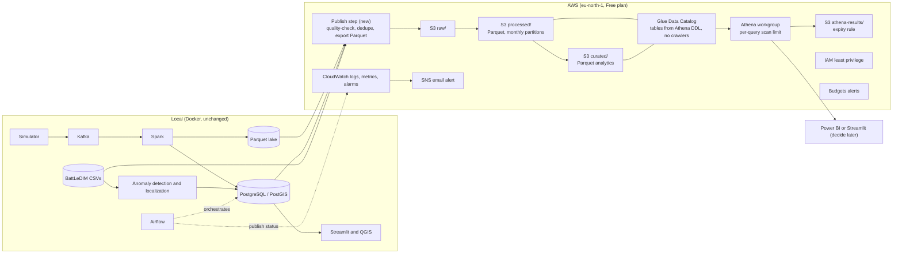

# AWS Cloud Layer: Architecture Design

**Status:** Approved design. Nothing has been deployed to AWS yet.
**Scope:** An optional cloud layer on top of the existing local platform.
The local pipeline (Kafka, Spark, Airflow, PostgreSQL/PostGIS,
Streamlit, QGIS) is unchanged and remains the system of record.

## 1. Goals and constraints

| Constraint | Decision |
|---|---|
| Budget | AWS **Free plan only**. No payment method is used and no paid upgrade is planned. |
| Local-first | The project must stay fully runnable locally. AWS adds a cloud layer; it does not replace anything. |
| Simplicity | Use the smallest set of services that demonstrates a data lake, a catalog, serverless SQL, monitoring and access control. |
| Honesty | Only features that have been implemented and tested are described as such. |

## 2. Account facts (confirmed in the AWS console)

| Item | Value |
|---|---|
| Sign-up type | New AWS sign-up experience (AWS Builder ID, one project) |
| Plan | Free |
| Credits | USD 100.00 at the start |
| Free period | 183 days from 8 October 2026 (ends 8 April 2027) |
| Region | Europe (Stockholm), `eu-north-1`, **assigned by AWS** |
| Charges | None. Access ends when credits are used or the free period ends. |

### What the new sign-up experience means for this design

| Topic | Consequence |
|---|---|
| No root user | Root credentials exist only in the advanced sign-up. Access is through the Builder ID login, protected with authenticator-app MFA. |
| Region is assigned | The region cannot be chosen on the Free plan. Opt-in regions (for example Cape Town) are not available. All scripts read the region from configuration. |
| IAM users | They can be created, but **only for programmatic access**. The CLI user will have access keys and no console password. |
| Advanced features | Activating them requires the Paid plan, so they are out of scope. |
| Time limit | The live environment ends on 8 April 2027. The repository must therefore contain rebuild scripts and saved evidence (see section 9). |

## 3. Service decisions

Free-plan eligibility is listed in AWS's documentation of supported
services. Eligible does **not** mean free: eligible services consume
credits unless an always-free allowance applies.

| Service | Decision | Reason |
|---|---|---|
| Amazon S3 | **Use** | Data lake storage (raw, processed, curated zones) |
| AWS IAM | **Use** | Least-privilege programmatic access |
| AWS Glue Data Catalog | **Use, no crawlers** | Table definitions for Athena, created with Athena DDL |
| Amazon Athena | **Use** | Serverless SQL over Parquet in S3 |
| Amazon CloudWatch and SNS | **Use, small** | Logs, metrics, alarms and email alerts |
| AWS Budgets | **Use** | Cost alerts |
| Glue crawlers | Skip | Schemas are already known; crawlers bill per run |
| Glue ETL jobs | Deferred | Local Spark already performs this work |
| dbt | Decide later | Only if Athena modelling needs it |
| Lambda, Step Functions, EventBridge | Skip | Nothing in the project needs event triggers |
| SageMaker | Skip | The Isolation Forest trains in seconds locally |
| MSK, Kinesis, Redshift, EMR | Skip | Paid-plan only, and unnecessary at about 12.5 million readings a year |
| RDS, Managed Airflow, EC2, NAT Gateway | Skip | Always-on hourly billing, replacing components that already work |

## 4. Architecture

### What stays local, and what moves

| Component | Location | Reason |
|---|---|---|
| Simulator, Kafka, Spark | Local | A managed equivalent would cost far more than it adds |
| PostgreSQL / PostGIS, QGIS, Streamlit | Local | The dashboard and spatial views depend on them |
| Anomaly detection and localization | Local | Runs in the `smart-water-ml` container |
| Airflow | Local | May gain a publish task later |
| Published Parquet datasets | **S3** | The cloud data lake |
| Table definitions | **Glue Data Catalog** | Needed by Athena |
| Ad-hoc SQL analytics | **Athena** | Serverless queries |
| Pipeline monitoring | **CloudWatch** | Logs and alarms |

### Datasets to publish

| Dataset | Source | Size |
|---|---|---|
| Full-year sensor readings (about 12.5 million rows) | Generated locally from the BattLeDIM CSV files | To be measured in Phase 3 |
| Anomaly results (101,088 rows) | PostgreSQL export | Small |
| Localization results (121,700 rows) | PostgreSQL export | Small |
| Reference tables (sensors, nodes, links) | PostgreSQL export | Small |

The 1,428-event streaming lake is too small to be an interesting Athena
dataset on its own.

## 5. Cost model

Prices below are **estimates** and must be confirmed for `eu-north-1`
with the AWS Pricing Calculator before resources are created.

| Item | Example | Estimate |
|---|---|---|
| S3 storage | 1 GB | about USD 0.02 per month |
| Athena | 200 queries a month scanning 100 MB each | about USD 0.10 (USD 5 per TB scanned, 10 MB minimum per query) |
| Glue Data Catalog | Well below the first million objects and requests | Free |
| CloudWatch, SNS, Budgets | Within free allowances | Free |
| **Total** | | **Well under USD 1 per month, drawn from credits** |

### Cost risks and guardrails

| Risk | Guardrail |
|---|---|
| Glue crawlers or ETL jobs created out of habit | Not part of the design. Any use needs explicit approval first. |
| Unbounded Athena scans | Dedicated workgroup with a per-query data limit (to be confirmed in the Athena documentation), Parquet, partition projection, no `SELECT *` |
| Log accumulation | Short CloudWatch log retention |
| Athena result files accumulating | Lifecycle expiry rule on the results prefix |
| Accidental paid upgrade | The Free plan is used throughout. **Never click Upgrade.** |

## 6. Security model

- **Account access:** Builder ID login with authenticator-app MFA.
- **CLI access:** one IAM user with programmatic access only, a
  least-privilege policy scoped to one bucket plus the specific Athena
  and Glue actions, and no wildcards.
- **Credentials:** stored only in the user's AWS CLI profile (`~/.aws`).
  They are **never** placed in the repository or in
  `infrastructure/postgres/.env`, because `run_spark_stream.cmd` passes
  that whole file into the Spark container.
- **Upload path:** the first publish step runs from the host Python
  environment, not inside Docker or Airflow. Giving a container AWS
  credentials next to the mounted Docker socket is a separate, later
  decision.
- **S3:** Block Public Access on, default encryption on, bucket policy
  that denies non-TLS access.
- **Repository:** `.gitignore` covers AWS credential files and keys, and a
  secret scan runs before every commit.
- **End of project:** deactivate and delete the IAM access keys.
- **Known trade-off:** AWS recommends temporary credentials over
  long-term IAM user keys. Long-term keys are used here because the new
  sign-up experience does not allow IAM users with console access, so the
  risk is reduced with narrow permissions, no key storage in the repo and
  key deletion at the end.

## 7. Migration strategy

1. All AWS work happens on the branch `aws-cloud-layer`.
2. Changes are additive: new folders for cloud scripts and Athena SQL.
3. Existing local code and behaviour are not modified without a recorded
   reason.
4. Each phase has tests, documentation and its own commit.
5. The local pipeline is re-verified at the end.
6. Nothing is merged into `main` until the final review is approved.

## 8. Implementation phases

Every phase waits for approval before the next begins.

| Phase | Work | Billable |
|---|---|---|
| 1 | This design | No |
| 2 | Account safety: MFA, Budgets alert, IAM user, AWS CLI profile, repository safeguards | No |
| 3 | S3 bucket, zone layout, partition plan | Cents |
| 4 | Publish script with a quality-check gate, de-duplication and Parquet export | Cents |
| 5 | Glue Data Catalog tables through Athena DDL, partition projection | None |
| 6 | Athena workgroup with limits, and a documented query library | Cents |
| 7 | Data modelling, and the decision on dbt | None |
| 8 | Optional Airflow publish task | None |
| 9 | CloudWatch alarms and SNS email alerts | Within free allowances |
| 10 | Security review, cost review and cleanup scripts | None |
| 11 | Water analytics using the 82 demand sensors (the dataset has no districts) | Cents |
| 12 | Power BI decision | Cents |
| 13 | README, rebuild scripts, final review and merge | None |

## 9. Lifecycle of the live environment

The Free plan ends on 8 April 2027. To keep the project valuable
afterwards, the repository will contain:

- scripts that recreate the cloud layer from scratch;
- the Athena DDL and query library;
- saved query results and screenshots;
- a cleanup procedure that removes every resource created.

## 10. Verification status of the facts used

| Level | Facts |
|---|---|
| **Confirmed in the console** | Free plan, USD 100 credits, 183 days, region `eu-north-1`, no charges |
| **Confirmed in AWS documentation** | Free-plan service eligibility; Redshift, EMR, MSK and Kinesis are Paid-plan only; assigned regions; programmatic-only IAM users; Glue Data Catalog free allowance and crawler rate; Budgets monitoring is free and the first two action-enabled budgets are free |
| **From secondary sources** | Athena at USD 5 per TB with a 10 MB minimum; S3 Standard at about USD 0.023 per GB-month in us-east-1; CloudWatch free allowances |
| **Not yet verified** | S3 and Athena prices for `eu-north-1`; the Athena per-query data-limit setting; Managed Airflow pricing (the service is not used); the status of the dbt Athena adapter |

## 11. How to explain this design

The platform was built and verified locally first with Kafka, Spark,
Airflow and PostgreSQL. The cloud layer publishes quality-checked
Parquet to S3 and queries it through the Glue Data Catalog and Athena.
Kafka, Spark, Airflow and the database deliberately stay local, because
at about 12.5 million readings a year managed equivalents would cost far
more than they add. Cost is controlled with Parquet, partitioning, scan
limits, Budgets alerts and the Free plan's hard stop. Access uses MFA and
a least-privilege IAM user with no credentials in the repository, and the
repository contains scripts to rebuild everything.
